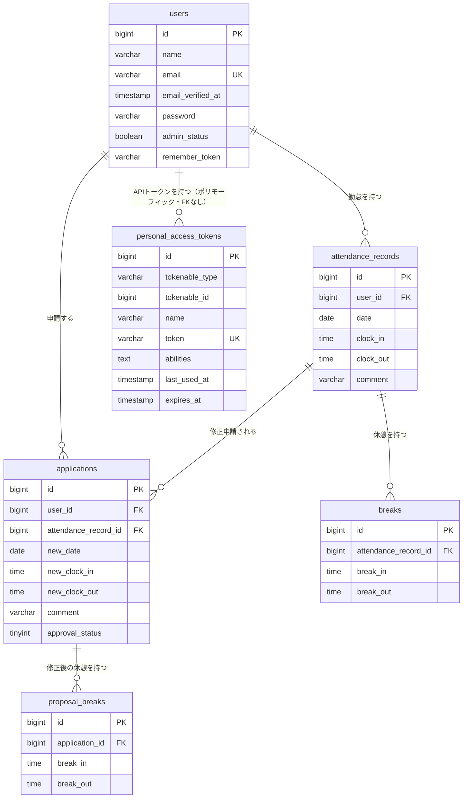

# テーブル仕様書（作業用・雛形書式）

> 記入ルールは同フォルダの `CLAUDE.md` を参照。

## 0. 共通ルール（全テーブルに適用）
| 項目 | 方針 | 根拠ラベル |
|---|---|---|
| テーブル名 | snake_case・複数形 | 【規約】Laravel |
| 主キー | `id` unsigned bigint auto increment | 【規約】Laravel |
| タイムスタンプ | `created_at` / `updated_at` | 【規約】Laravel |
| 勤務日 | `date` 型で、勤怠テーブルに独立した列として持つ。1人1日1件（`user_id` + `date` の複合UNIQUE） | [出典: API仕様書（応用） §勤怠登録 リクエスト（date: date / unique:attendance_records,date,user_id 複合）] |
| 時刻（出勤・退勤・休憩開始・休憩終了） | `time` 型（HH:MM:SS）で持ち、日付は持たない。どの日の時刻かは勤怠テーブルの `date` で決まる | 出勤・退勤: [出典: API仕様書（応用） §勤怠登録 リクエスト（clock_in / clock_out: time）]／休憩: 【導出】詳細レスポンス例の `break_in` が `"12:00:00"` 形式であり、休憩は勤怠に属するので出勤・退勤と型を揃える |
| 日をまたぐ勤務 | 扱わない。退勤は「出勤と同じ日の、出勤より後の時刻」に限られる | 【導出】`time` 型 + `after:clock_in`（API仕様書（応用） §バリデーション）／Q-007 回答 A（2026-10-28） |
| Laravel 標準のテーブル | `password_reset_tokens`・`failed_jobs` のマイグレーションは削除し、仕様書にも載せない。`personal_access_tokens` は Laravel 10 に最初から入っているので残し、仕様書にも載せる（2026-11-12 変更） | 【設計判断・2026-11-08 承認】パスワード再設定・キューは仕様に無い。開発プロセス「マイグレーションファイルとテーブル仕様書が一致」を満たすため |

## テーブル定義（雛形書式。Q-002 = B）

| \*\*\*\* |                  |              |        |                 |                |              |                 |
| -------- | ---------------- | ------------ | ------ | --------------- | -------------- | ------------ | --------------- |
| **No.**  | **テーブル名**   | **カラム名** | **型** | **PRIMARY KEY** | **UNIQUE KEY** | **NOT NULL** | **FOREIGN KEY** |
| **1** | **users** | id | unsigned bigint | ○ |  | ○ |  |
|  |  | name | varchar(255) |  |  | ○ |  |
|  |  | email | varchar(255) |  | ○ | ○ |  |
|  |  | email_verified_at | timestamp |  |  |  |  |
|  |  | password | varchar(255) |  |  | ○ |  |
|  |  | admin_status | boolean |  |  | ○ |  |
|  |  | remember_token | varchar(100) |  |  |  |  |
|  |  | created_at | timestamp |  |  |  |  |
|  |  | updated_at | timestamp |  |  |  |  |
| **2** | **attendance_records** | id | unsigned bigint | ○ |  | ○ |  |
|  |  | user_id | unsigned bigint |  | ○（user_id + date の複合） | ○ | users(id) |
|  |  | date | date |  | ○（user_id + date の複合） | ○ |  |
|  |  | clock_in | time |  |  | ○ |  |
|  |  | clock_out | time |  |  |  |  |
|  |  | comment | varchar(255) |  |  |  |  |
|  |  | created_at | timestamp |  |  |  |  |
|  |  | updated_at | timestamp |  |  |  |  |
| **3** | **breaks** | id | unsigned bigint | ○ |  | ○ |  |
|  |  | attendance_record_id | unsigned bigint |  |  | ○ | attendance_records(id) |
|  |  | break_in | time |  |  | ○ |  |
|  |  | break_out | time |  |  |  |  |
|  |  | created_at | timestamp |  |  |  |  |
|  |  | updated_at | timestamp |  |  |  |  |
| **4** | **applications** | id | unsigned bigint | ○ |  | ○ |  |
|  |  | user_id | unsigned bigint |  |  | ○ | users(id) |
|  |  | attendance_record_id | unsigned bigint |  |  | ○ | attendance_records(id) |
|  |  | new_date | date |  |  | ○ |  |
|  |  | new_clock_in | time |  |  | ○ |  |
|  |  | new_clock_out | time |  |  |  |  |
|  |  | comment | varchar(255) |  |  | ○ |  |
|  |  | approval_status | unsigned tinyint |  |  | ○ |  |
|  |  | created_at | timestamp |  |  |  |  |
|  |  | updated_at | timestamp |  |  |  |  |
| **5** | **proposal_breaks** | id | unsigned bigint | ○ |  | ○ |  |
|  |  | application_id | unsigned bigint |  |  | ○ | applications(id) |
|  |  | break_in | time |  |  | ○ |  |
|  |  | break_out | time |  |  |  |  |
|  |  | created_at | timestamp |  |  |  |  |
|  |  | updated_at | timestamp |  |  |  |  |
| **6** | **personal_access_tokens** | id | unsigned bigint | ○ |  | ○ |  |
|  |  | tokenable_type | varchar(255) |  |  | ○ |  |
|  |  | tokenable_id | unsigned bigint |  |  | ○ |  |
|  |  | name | varchar(255) |  |  | ○ |  |
|  |  | token | varchar(64) |  | ○ | ○ |  |
|  |  | abilities | text |  |  |  |  |
|  |  | last_used_at | timestamp |  |  |  |  |
|  |  | expires_at | timestamp |  |  |  |  |
|  |  | created_at | timestamp |  |  |  |  |
|  |  | updated_at | timestamp |  |  |  |  |

**根拠メモ（列ごとの出典・削除時の挙動・インデックス）**
- 雛形の 7〜9 番の枠は使わないので削除した（テーブルは 6 つ。1〜5 は Model 表の 5 モデル、6 は Sanctum 付属）。
- 共通: `id`・`created_at`・`updated_at` … 【規約】Laravel（`timestamps()` は NULL 可で作られるため NOT NULL は付けない）。文字列は `varchar(255)` … 【設計判断・2026-11-09 承認】D-8（バリデーションの `max:255` と揃える）。

**users**
- `name`・`email`・`password` … [出典: views/user/register の `name=` / basic-design バリデーション表 RegisterRequest]。`email` の UNIQUE … `unique:users,email`（Q-031 A）、ログインの識別子。
- `email_verified_at` … [出典: 機能要件一覧.md FN011]（Fortify のメール認証）。未認証の間は空なので NULL 可。
- `admin_status` … [出典: 開発プロセス.md §ダミーデータ「admin_status = true」/ views/layouts/admin-app]。初期値 `false` は【設計判断】（会員登録で作られるのは一般ユーザーだけ）。
- `remember_token` … 【規約】Laravel 標準の users マイグレーション。
- 列にしないもの: `password_confirmation`（確認用の入力欄）、`attendance_status`（今日の勤怠から計算。【設計判断・2026-11-09 承認】D-2、アクセサで返す）。

**attendance_records**
- テーブル名 … [出典: 開発プロセス.md §ダミーデータ / 機能要件一覧.md FN060]。
- `user_id`・`date`・`clock_in`・`clock_out`・`comment` … [出典: API仕様書（応用）.md AP03 リクエスト・§API Resource の構造 / views/user/user-attendance-list・user-detail]。
- `user_id` + `date` の複合 UNIQUE … [出典: §0 共通ルール「勤務日」/ FN060「この日付の勤怠は既に登録されています」]。
- `clock_in` NOT NULL … 【導出】勤怠は出勤の打刻で作られる（FN020）。AP03 でも必須。`clock_out` NULL 可 … 【導出】退勤するまで値が無い（AP03 で任意、Q-032 A）。`comment` NULL 可 … AP03 で任意。承認時に申請の備考を反映する（Q-029 A）。
- 計算値の返す形（【設計判断・2026-11-16 承認】D-1 の詳細）: `total_break_time` は `break_out` がある休憩の時間の合計、`total_time` は 退勤 − 出勤 − 休憩の合計。どちらも `"H:i"`（例 `"08:00"`）の文字列で返し、分未満は切り捨て。退勤前（`clock_out` が null）の `total_time` は null。休憩が0回（または全部が休憩中）の `total_break_time` は `"00:00"`（2026-11-18 ユーザー決定。休憩0分は事実なので画面に `0:00` と出す）。根拠【導出】: views（user-attendance-list・admin-attendance-list・staff-attendance-list）が `値 ? Carbon::parse(値)->format('G:i') : ''`、API仕様書（応用）の例が `"total_time": "08:00"`。代替案: 分の数で返す（不採用。`Carbon::parse` で読めない）
- 時刻の列（`clock_in`・`clock_out`、breaks・applications・proposal_breaks の時刻の列）は `$casts` を付けず文字列（`"09:00:00"`）のまま扱う（【設計判断・2026-11-16 承認】）。計算のときだけ `Carbon::parse()` で読む。秒を出さない整形は画面を作る Controller で行う。代替案: `'datetime:H:i'` に変換（不採用。日付の無い時刻に今日の日付が付き、ずれの元になる）
- 列にしないもの: `total_time`・`total_break_time`（出勤・退勤・休憩から計算。【設計判断・2026-11-09 承認】D-1）、`month`（API の検索条件）、`new_*`（修正申請の値なので applications へ）。

**breaks**
- テーブル名 … [出典: 開発プロセス.md §ダミーデータ「休憩（breaks）」]。モデル `AttendanceBreak` に `$table = 'breaks'` を指定する。
- `break_in`・`break_out` … [出典: API仕様書（応用）.md AP02 レスポンス例 / views/user/user-detail（`$break['break_in']`）]。`break_in` NOT NULL・`break_out` NULL 可 … 【導出】休憩の打刻で開始時刻は必ずあり、休憩中は終了時刻が無い（FN021）。

**applications**
- `attendance_record_id` … 【導出】views: `$application->AttendanceRecord->date`（どの勤怠への申請か）。
- `user_id` … 【設計判断・2026-11-09 承認】D-5。views: `$application->user->name` をそのまま使え、一般ユーザーの「自分の申請」の絞り込み（FN031）も簡単になる。代替案: 勤怠経由でたどる（不採用）。
- `new_date` … 【設計判断・2026-11-09 承認】views/admin/admin-application-detail の `$application->new_date->format()`（日付としてキャスト）、フォームの `new_date`。日付は修正できない（readonly）ので勤怠の `date` と同じ値が入る。
- `new_clock_in` NOT NULL・`new_clock_out` NULL 可 … [出典: views/admin/admin-application-detail / basic-design バリデーション表（`new_clock_in` required、`new_clock_out` nullable＝Q-032 A）]。
- `comment` NOT NULL … [出典: FN029「備考を記入してください」]（申請の備考は必須）。
- `approval_status` … [出典: views（`=== '承認待ち'` / `=== '承認済み'`）/ FN031・FN032・FN051]。【設計判断・2026-11-09 承認】D-3: 数字で持ち、アクセサで文字に変えて返す。値は `1` = 承認待ち（初期値）、`2` = 承認済み（0 は「未設定」と紛れるので使わない）。モデルに定数（例: `STATUS_PENDING = 1`）を作り、検索・更新では定数を使う。注意: アクセサは列と同じ名前なので、`$application->approval_status` は文字列、`where('approval_status', …)` や保存は数字になる（読むときと書くときで形が違う）。代替案: 文字列で持つ（ビューをそのまま使えるが打ち間違えに弱い）。想定外の値（1・2 以外）のときはアクセサが `'不明'` を返す（【設計判断・2026-11-17 承認】。画面を止めない。代替案: default なしの `match` で例外にして気づく（不採用））
- `application_date` の返す形（【設計判断・2026-11-16 承認】D-4 の詳細）: `created_at` を `'Y/m/d'`（例 `"2026/11/16"`）の文字列で返す。根拠【導出】: views/user/user-application-list はそのまま表示、views/admin/admin-application-list は `Carbon::parse(...)->format('Y/m/d')`。両方で同じ表示になる。代替案: Carbon のまま返す（不採用。一般ユーザーの画面に時刻まで出る）
- `new_date` は `$casts` で `date` にする【導出】: views/admin/admin-application-detail が `$application->new_date->format('Y年')` と Carbon のメソッドを直接呼ぶため
- 列にしないもの: `application_date`（`created_at` から計算。【設計判断・2026-11-09 承認】D-4）、`date`（勤怠の `date` をたどる）、`tab_item`（画面のタブ切り替え部品）。

**proposal_breaks**
- `application_id`・`break_in`・`break_out` … [出典: views/admin/admin-application-detail（`$application->proposalBreaks` の `$break->break_in` / `$break->break_out ? … : ''`）]。`break_out` NULL 可 … 【導出】ビューが空を想定しており、休憩中でも申請できる（Q-032 A）。

**削除時の挙動**
- `attendance_records` を削除 → `breaks`・`applications` も削除（cascade）… [出典: API仕様書（応用）.md AP05「ON DELETE CASCADE」]。
- `applications` を削除 → `proposal_breaks` も削除（cascade）… 【導出】AP05 で申請が連鎖削除されるとき、修正後の休憩が残ると参照先が無くなる。
- `users` を削除 → 勤怠・申請があれば削除を止める（restrict）… Q-015 B。

**personal_access_tokens**
- 列はすべて【規約】Laravel 10 標準の `2019_12_14_000001_create_personal_access_tokens_table.php`（Sanctum）。[出典: API仕様書（応用）.md 手順 3「personal_access_tokens テーブル作成」]。
- 最初から残すのは【設計判断・2026-11-12 承認】。理由: Laravel 10 に最初から入っており、消して応用で戻すと手間と記載漏れの危険が増える。代替案: 基本では削除し応用で追加（不採用）。
- `tokenable_type` + `tokenable_id` はポリモーフィック（`morphs()`）。「どのモデルのトークンか」を 2 列で表すため外部キー制約は無く、2 列の複合インデックスが自動で作られる。この課題では users のトークンだけを使う。

**インデックス**
- 自動でできる索引: 主キー `id`・UNIQUE の列（`users.email`・`personal_access_tokens.token`・`attendance_records` の `user_id` + `date`）・外部キーの列（MySQL が自動で作る）。
- `user_id` + `date` の複合 UNIQUE は、**先頭の列 `user_id` を条件に含む検索**（一般ユーザーの月次一覧 US007: `user_id` と月の範囲）の索引を兼ねる。
- 管理者の日次一覧（US010: `date` だけで全員を検索）には、先頭の列を使わないため**この索引は効かない**（複合索引は左端の列から順にしか使えない）。
- 【設計判断・2026-11-14 承認（案 A）】これ以外の索引は作らない。理由: ダミーデータは数百行で、全行を読んでも速さに差が出ない。索引を増やすと保存が遅くなり、マイグレーション・仕様書の手間も増える。代替案: `attendance_records.date` に単独の索引を足す（不採用。遅くなったと確かめられたら足す）。

## ER図

## マイグレーション作成順
1. `users`（Laravel 標準。`admin_status` を追加）
2. `personal_access_tokens`（Laravel 標準。ファイル名が 2019 年なので 2 番目に動く。外部キーが無いので順番の制約は無い）
3. `attendance_records`（users を参照）
4. `breaks`（attendance_records を参照）
5. `applications`（users・attendance_records を参照）
6. `proposal_breaks`（applications を参照）
- 【規約】外部キーの参照先を先に作る（`docs/02_table-design/CLAUDE.md` 手順 8）。

## 変更履歴
| 日付 | 内容 | 理由 |
|---|---|---|
| 2026-10-28 | §0 共通ルールに「勤務日」「時刻」「日をまたぐ勤務」の3行を追加 | 日付・時刻の持ち方を全テーブルで統一するため。出典: API仕様書（応用） §勤怠登録。日またぎ勤務は Q-007 で確認中 |
| 2026-10-28 | 雛形書式に切り替え（§0 共通ルールは維持） | Q-002 回答 B |
| 2026-11-08 | §0 に「Laravel 標準のテーブル」の行を追加 | ユーザー承認（不要な標準テーブルは削除） |
| 2026-11-09 | テーブル定義 5 つ・根拠メモ・ER 図・マイグレーション作成順を記入 | ユーザー案を採点し模範解答を反映。D-1・D-2・D-4・D-5・D-8・new_date をユーザーが承認（D-3 は承認待ち） |
| 2026-11-09 | `approval_status` を unsigned tinyint（1=承認待ち・2=承認済み、アクセサで文字に変換）に変更 | ユーザー決定 D-3 |
| 2026-11-12 | `personal_access_tokens` をテーブル定義 6・根拠メモ・ER 図・マイグレーション作成順に追加。§0 の扱いを変更 | ユーザー決定（Laravel 10 に最初からあるので残す） |
| 2026-11-14 | 根拠メモ「インデックス」を書き直し（複合 UNIQUE は US010 の日付だけの検索に効かないことを明記。ほかの索引は作らない） | 前のメモの誤りを訂正。インデックス方針はユーザー承認（案 A） |
| 2026-11-16 | 根拠メモに D-1・D-4 の返す形、時刻の列の `$casts` を付けないこと、`new_date` の date キャストを追加 | kikaku の指摘（設計書に無かった）。ビューと API の使われ方から導き、ユーザー承認（3つとも案 A） |
| 2026-11-17 | D-3 に想定外の値のとき `'不明'` を返すことを追加 | ユーザー決定（M5 の採点で sensei が選択肢を提示） |
| 2026-11-18 | D-1 に「休憩0回の `total_break_time` は `"00:00"`」を追加 | ユーザー決定（M6 の実装前に確認） |
